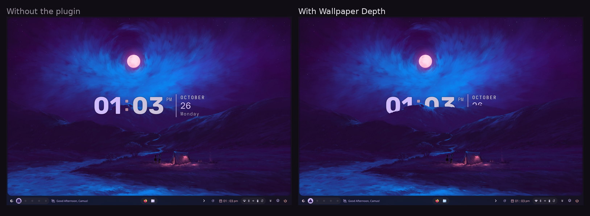
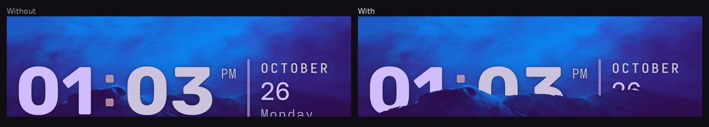
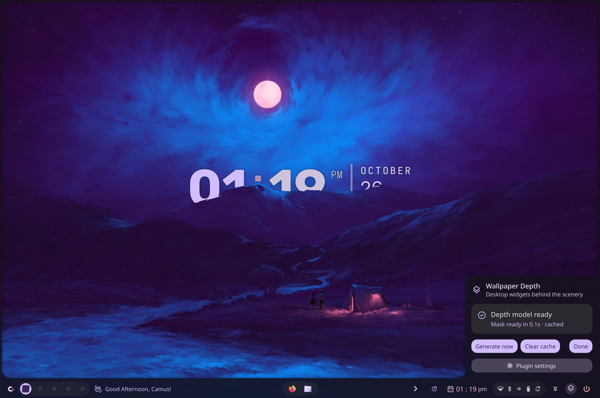

# Wallpaper Depth

Estimates a depth map for the current wallpaper on this machine, then redraws the
wallpaper's foreground above the desktop. Desktop widgets, icons and the clock end
up behind whatever the model considers close to the camera — trees, hills, furniture,
a character standing in front of the frame.

A port of the Noctalia plugin of the same name to Caelestia on KDE Plasma, using the
same model, the same pipeline and the same default settings.

Same wallpaper, same desktop layout, only the plugin differs — the ridge in the middle
distance is foreground, so it cuts through the clock:



Detail of the same pair: the ridge takes the bottom off "01:03" and hides the date.



The panel: model state, the re-run actions, and a shortcut to the settings:



> Both shots use the automatic threshold, which picked a cut at 6 % and put 49 % of
> this wallpaper in front.

## How it works

1. `depth_helper.py` runs [Depth Anything V2 Small](https://huggingface.co/onnx-community/depth-anything-v2-small-ONNX)
   (quantized ONNX export, Apache-2.0) through ONNX Runtime on the CPU.
2. The relative depth prediction is normalized and edge-refined against the source
   image with a guided filter. The cut-off is either **automatic** (just above the
   depth the empty background occupies) or the manual **Foreground threshold**, with a
   soft **Edge feather** band around it.
3. The result is saved as an alpha mask at the wallpaper's resolution, next to a
   cached depth map.
4. A background widget re-draws the wallpaper on top of the other desktop widgets,
   using that mask as its alpha, so only the foreground pixels cover them.

Depth maps are cached per wallpaper, so changing the threshold or the feather only
reruns the cheap mask pass. Masks are keyed by wallpaper contents, model revision and
pipeline version, and old entries are pruned automatically. Nothing leaves the
machine except the one-time model download.

## Requirements

- Caelestia shell 2.6.3 or newer, with desktop widgets (the background window) enabled.
- `python3` 3.11 or newer with `venv` and `pip`. The plugin creates its own virtual
  environment; the system Python is never modified.
- Network access once, to download the ~39 MB model. Everything afterwards is local.

On NixOS and Guix, install `numpy`, `onnxruntime` and `pillow` system-wide instead;
the plugin uses them and skips the virtual environment.

## Setup

1. Enable the plugin in Nexus → Plugins, then add its bar widget if you want the
   status panel (the widget opens the panel; it is not required for the effect).
2. Open the **Wallpaper Depth** panel from the bar and choose **Install model**. This
   creates `~/.local/share/caelestia/plugins/wallpaper-depth/runtime/.venv`, installs
   the runtime, and downloads the model into `…/models/`.
3. Set an image wallpaper. With **Generate automatically** on (the default) the mask
   is generated whenever the wallpaper changes.

The panel also offers **Generate now** and **Clear cache**.

## Settings

| Setting | Type | Default | Description |
| --- | --- | --- | --- |
| Generate automatically | toggle | on | Regenerate the mask when the wallpaper or a mask parameter change. |
| Automatic threshold | toggle | on | Pick the cut-off from the picture: just above the depth plateau that sky and other flat backdrop occupy. |
| Foreground threshold | number 0-100 | 30 | Manual cut-off, used when the automatic one is off. Same semantics and default as upstream. |
| Edge feather | number 0-50 | 8 | Width of the soft transition around the cut-off. |

Settings live in Nexus → Plugins → Wallpaper Depth; the **Plugin settings** button in the
panel takes you to that page. Changing them rebuilds the plugin and regenerates the mask
within a few seconds.

## How the cut is chosen

Depth is normalized per picture, so one fixed number cannot suit every wallpaper: a
character portrait puts its subject at 0.35, while the tree line of a landscape sits at
0.10-0.18 and a distant mountain at 0.08. Upstream's fixed default of 30 therefore
selects only the very nearest 10-15 % of most photographs.

With **Automatic threshold** on (the default) the helper reads the depth histogram
instead. Sky, haze and other empty backdrop collapse into one narrow, very tall peak;
everything the eye reads as scenery sits above it. The cut goes just past that peak,
clamped to 0.06-0.35:

| Picture | Background peak | Cut chosen | Subject | Backdrop |
| --- | --- | --- | --- | --- |
| character artwork | 0.01 | 0.19 | body 0.74, head 0.41 | 0.00 |
| plane in a field | 0.00 | 0.06 | plane 0.78, tail 0.60 | sky 0.00 |
| forest and snow field | 0.00 | 0.06 | trees 0.84, snow 1.00 | sky 0.00 |
| road towards a mountain | 0.00 | 0.06 | peak 0.81, fog 1.00 | sky 0.00 |

Turn it off to use the manual **Foreground threshold** exactly like upstream — the
right choice when only the closest thing should occlude.

## Seeing the effect

The foreground is re-drawn on top of the desktop, so the effect is only visible where
something on the desktop overlaps it. Drag the clock or the shapes widget into the
foreground in desktop edit mode, or put the widget over the subject.

`caelestia-shell-ipc call wallpaper-depth status` reports the parameters the mask was
generated with (`maskThreshold`, `maskFeather`), the cut the automatic rule settled on
(`cut`) and the share it actually covers (`coverage`).

## IPC

```sh
caelestia-shell-ipc call wallpaper-depth status
caelestia-shell-ipc call wallpaper-depth setup
caelestia-shell-ipc call wallpaper-depth generate
caelestia-shell-ipc call wallpaper-depth clearCache
caelestia-shell-ipc call wallpaper-depth refresh
caelestia-shell-ipc call wallpaper-depth panel
```

## Limitations

- Static images only. Videos and animated wallpapers are skipped because there is no
  stable frame to mask.
- One mask per wallpaper, not per output: every screen shares the same wallpaper, and
  each screen crops it with the configured wallpaper fill mode.
- Dark, low-contrast subjects can be predicted as "far": a dark helmet against a bright
  glow may land below the threshold even though it is in front. Lowering the threshold
  brings it in.
- The desktop window must be the topmost thing above the wallpaper. If another program
  draws the wallpaper on the background layer, that is still fine; if the desktop
  itself is disabled (`background.disableQuickshellDesktop`), the overlay has nothing to
  sit on.

## Data locations

| Path | Contents |
| --- | --- |
| `~/.local/share/caelestia/plugins/wallpaper-depth/runtime/` | Virtual environment and the generate lock |
| `~/.local/share/caelestia/plugins/wallpaper-depth/models/` | `depth-anything-v2-small-quantized` |
| `~/.local/share/caelestia/plugins/wallpaper-depth/cache/depth/` | Normalized depth maps (`.npy`), last 8 |
| `~/.local/share/caelestia/plugins/wallpaper-depth/cache/masks/` | Foreground masks (`.png`) and their cut/coverage sidecars (`.json`), last 32 |

## Licensing

MIT, see [LICENSE](LICENSE). The original Noctalia plugin is MIT as well. The model is
not bundled: it is downloaded at setup time and is Apache-2.0.
